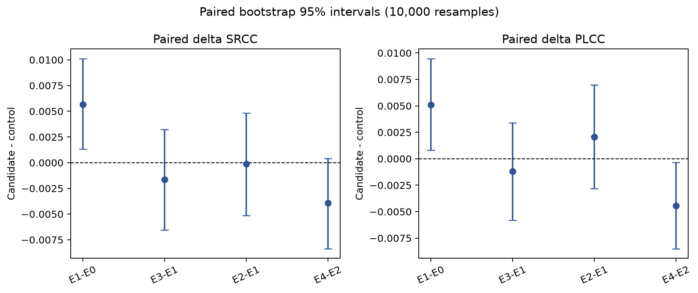
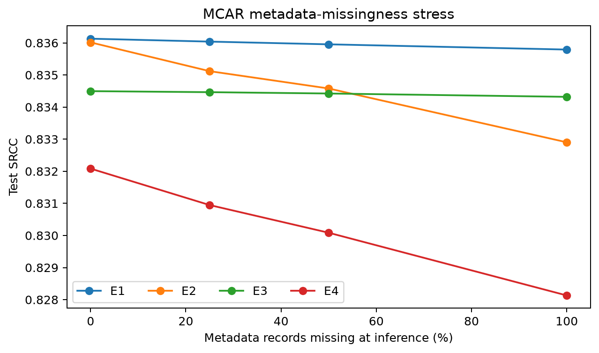

# When Does EXIF Help Smartphone Image Quality Assessment?

This repository is an executed, resource-adapted study of when EXIF helps image-quality prediction on SPAQ. It preserves a five-model frozen-feature baseline and extends it with three training seeds, correct-pair permutation, feature-group and missingness diagnostics, capture-condition subgroups, a matched backbone-tuning experiment, and independent Kaggle GPU replication. The main finding is cautionary: EXIF effects are small and seed-dependent, while gated fusion is not consistently better than additive fusion.

This is not a claim of reproducing the original SPAQ training numbers. The study uses one frozen ImageNet-V2 ResNet-50 feature cache so all variants can be executed and controlled within available compute. The original SPAQ and TOPIQ paper values remain literature references only.

## Preserved Baseline v0.1

All rows use seed `20261109`, split SHA-256 `91a8d1...a108`, manifest SHA-256 `abff8b...5800d`, and frozen feature cache SHA-256 `b639bb...975ed`.

| Experiment | Change from control | Test SRCC | Test PLCC | Test MAE |
|---|---|---:|---:|---:|
| E0 | Image-only head | 0.83048 | 0.83063 | 9.3489 |
| E1 | E0 + 16-parameter additive EXIF offset | **0.83613** | 0.83572 | 9.1942 |
| E2 | E1 fusion replaced by 8,704-parameter gate | 0.83602 | **0.83779** | **9.1179** |
| E3 | E1 + 50% record-level metadata dropout | 0.83450 | 0.83452 | 9.2534 |
| E4 | E2 + 50% record-level metadata dropout | 0.83208 | 0.83337 | 9.3265 |

The prespecified E1-E0 paired difference is +0.00565 SRCC with 95% bootstrap interval [0.00132, 0.01013]. E2-E1 is -0.00012 [-0.00516, 0.00484], so the gated mechanism has no reliable SRCC advantage here. These intervals measure test-image sampling uncertainty, not training-seed uncertainty.



At 100% missing test EXIF, SRCC is 0.83579/0.83290/0.83432/0.82813 for E1/E2/E3/E4. Training-time metadata dropout did not improve either fusion family.



Baseline v0.1 is immutable at Git tag `baseline-v0.1`. Every E0-E4 config, checkpoint, log, prediction, manifest, and feature-cache hash is re-audited in `evidence/phase7_baseline_v01_audit.json`. These are frozen ResNet-50 features, not end-to-end fine-tuning.

## Phase 7 findings

The local three-seed E1-E0 mean test delta SRCC is +0.001878, with seedwise values +0.005649, -0.003524, and +0.003508. High-ISO, long-exposure, and night subsets have larger mean deltas, but none stays positive across all three seeds; H1 therefore fails its registered support rule.

Correct image-EXIF pairing beats five fixed whole-record permutations by +0.000351 SRCC for E1 and +0.002593 for E2, positive at every training seed. H2 meets its registered rule, but the effect is small and shows pairing sensitivity rather than causal or out-of-dataset utility. Inference-only feature-group tests are diagnostics, not retrained causal ablations.

E2-E1 mean delta SRCC is -0.001317 locally and negative at all three seeds. An independent Kaggle Tesla T4 retraining gives mean E2-E1 -0.001646 and mixed signs. H3 is not supported in either environment, so the simpler additive fusion remains preferable.

The exploratory one-seed matched image-pipeline comparison on Kaggle gives:

| Backbone arm | Trainable parameters | Validation SRCC | Test SRCC | Test PLCC | Test MAE |
|---|---:|---:|---:|---:|---:|
| Frozen ResNet-50 | 524,801 | 0.82977 | 0.85134 | 0.85281 | 8.7603 |
| Fine-tuned `layer4` | 15,489,537 | 0.87023 | 0.88187 | 0.88455 | 8.1856 |

Fine-tuning improves test SRCC by 0.03052 in this matched run. Because H4 has one seed, it is exploratory and not a general backbone claim. See [Phase 7 report](docs/PHASE7_EXPERIMENT_REPORT.md) and the hash-linked evidence files.

After the core hypotheses were complete, the official KonIQ-trained `topiq_nr` checkpoint was evaluated as an exploratory cross-dataset baseline. A validation-only affine MOS calibration followed by one test inference produced SRCC/PLCC/MAE 0.82005/0.82685/9.0969. This is not a matched-budget comparison and does not beat the SPAQ-trained heads. The `topiq_nr-spaq` checkpoint was deliberately excluded because training on SPAQ would contaminate the held-out comparison.

## Data provenance and license caution

The original SPAQ Drive link is broken. The recovery chain is:

- Compact image variant: `q-future/q-align-datasets`, revision `3da8831b...e376`, `spaq.tar`, 2,626,897,920 bytes, SHA-256 `d312242f...2194`.
- Author-recommended originals and workbooks: `chaofengc/IQA-PyTorch-Datasets`, revision `f97c4f5d...1bef`, `spaq.tgz`, 34,841,101,349 bytes, SHA-256 `54e0cb49...7418f7`.
- Exact case-sensitive filename join: 11,125/11,125 with no orphan or collision.

The compact archive has no annotations and no embedded EXIF. The larger archive contains 11,125 original JPEGs and three authentic workbooks. Embedded EXIF was inspected in every original: scene brightness is observed in 8,546 rows and author-estimated in 2,579. No EXIF or MOS value is fabricated. `03461.jpg` has invalid raw exposure and remains explicitly invalid; the separate author APEX value is retained with provenance.

The mirror card's license does not prove that all underlying SPAQ photographs are relicensed. Raw images/workbooks remain Git-ignored and are not redistributed. See [dataset recovery](docs/DATASET_RECOVERY.md) and [provenance](data/provenance.json).

## Leakage protection

The compact images contain 322 byte-identical pairs, 321 with different MOS. A dHash radius-four audit adds 747 non-exact repeated-content candidates. All 1,069 candidate edges are grouped before splitting, yielding 7,786 train, 1,111 validation, and 2,228 test rows with zero candidate-edge crossings. The inherited Q-Align split was rejected because it separates 103 exact pairs.

## Environment and setup

The executed environment used Python 3.12.10, PyTorch 2.14.1+cu130, torchvision 0.29.1+cu130, and an RTX 4050 Laptop GPU.

```powershell
py -3.12 -m venv .venv312
.\.venv312\Scripts\python.exe -m pip install --upgrade pip
.\.venv312\Scripts\python.exe -m pip install torch torchvision --index-url https://download.pytorch.org/whl/cu130
.\.venv312\Scripts\python.exe -m pip install -e ".[dev,analysis]"
.\.venv312\Scripts\python.exe -m pytest -q
```

Dataset acquisition is intentionally not hidden behind an unverified downloader. Download the two pinned objects above, verify their exact byte counts/SHA-256, and use the audit/build scripts documented in [dataset recovery](docs/DATASET_RECOVERY.md). The tracked `data/manifest.parquet` is the frozen row contract; raw files are ignored.

## Reproduce the resource-adapted experiments

Assuming compact images are extracted under `data/raw/q_align/extracted/spaq`:

```powershell
$py = ".\.venv312\Scripts\python.exe"
& $py scripts\extract_features.py --manifest data\manifest.parquet --image-root data\raw\q_align\extracted\spaq --output artifacts\features\spaq_resnet50_imagenet_v2_abff8b1a.npz --evidence-output evidence\feature_cache_resnet50.json
$commit = git rev-parse HEAD
foreach ($e in "E0","E1","E2","E3","E4") {
  $id = $e.ToLower()
  & $py scripts\train_cached_head.py --experiment $e --manifest data\manifest.parquet --features artifacts\features\spaq_resnet50_imagenet_v2_abff8b1a.npz --output-dir "artifacts\runs\${id}_frozen_r50_s20261109" --evidence-output "evidence\${id}_frozen_r50_s20261109.json" --source-commit $commit --seed 20261109
}
& $py scripts\evaluate_missingness.py --manifest data\manifest.parquet --features artifacts\features\spaq_resnet50_imagenet_v2_abff8b1a.npz --e1-checkpoint artifacts\runs\e1_frozen_r50_s20261109\best.pt --e2-checkpoint artifacts\runs\e2_frozen_r50_s20261109\best.pt --e3-checkpoint artifacts\runs\e3_frozen_r50_s20261109\best.pt --e4-checkpoint artifacts\runs\e4_frozen_r50_s20261109\best.pt --predictions-output artifacts\runs\missingness_all_s20261109\predictions.csv --summary-output evidence\missingness_all_s20261109.json
& $py scripts\analyze_results.py --seed 20261109 --bootstrap-resamples 10000
```

E0-E4 use validation SRCC for early stopping and open the test set only for final prediction. Configs, checkpoints, logs, and per-image predictions are retained under ignored `artifacts/runs/`; hashes are in tracked evidence JSON.

Phase 7 local aggregation and diagnostics are reproduced with:

```powershell
$py = ".\.venv312\Scripts\python.exe"
& $py scripts\analyze_phase7_multiseed.py
& $py scripts\evaluate_phase7_metadata.py
& $py scripts\verify_phase7_kaggle_backbone.py
& $py scripts\verify_phase7_kaggle_cached.py
& $py -m pip install -e ".[iqa]"
& $py scripts\evaluate_topiq_crossdataset.py
```

Standalone Kaggle runners and metadata templates are under `kaggle/phase7_backbone/` and `kaggle/phase7_cached/`. They verify manifest/cache/weight hashes before training and produce validation-selected checkpoints, epoch logs, and held-out predictions.

## Kaggle execution

Three private kernels completed on Tesla T4:

- `longltrnhong/spaq-exif-robustness-smoke` v2: data/GPU/checkpoint smoke.
- `longltrnhong/spaq-phase-7-matched-backbone-pair` v1: full frozen-versus-layer4 image training.
- `longltrnhong/spaq-phase-7-cached-multiseed` v1: nine independent E0/E1/E2 training runs.

All outputs were downloaded and independently checked against the frozen test IDs, labels, recorded metrics, checkpoints, logs, and SHA-256 values. Credentials and large outputs remain ignored; tracked verification is in `evidence/phase7_kaggle_backbone_v1.json` and `evidence/phase7_kaggle_cached_v1.json`.

## Repository map

- [Experiment report](docs/EXPERIMENT_REPORT.md): methods, results, limitations, and citations.
- [Research direction](docs/RESEARCH_DIRECTION.md): original SPAQ contribution, project difference, novelty boundaries, and hypotheses.
- [Phase 7 report](docs/PHASE7_EXPERIMENT_REPORT.md): multiseed, reliability, subgroup, and backbone results.
- [Acceptance audit](docs/ACCEPTANCE_AUDIT.md): gate-by-gate evidence and remaining blockers.
- `evidence/`: execution summaries, paired tables, hashes, and environment evidence.
- `scripts/`: data audits, split/manifest construction, training, robustness, and analysis.
- `src/spaq_iqa/`: tested data, EXIF, metric, model, and grouping components.
- `PROJECT_STATUS.md`, `STATE.json`, `TASKS.md`, `SESSION_HANDOFF.md`: persistent resume state.

## Main limitations

- Three cached-head seeds quantify limited optimization variability; they are not a population-level random-effects study.
- Frozen, downsampled/re-encoded visual inputs; not a faithful SPAQ end-to-end reproduction.
- H4 layer4 fine-tuning has one seed and is exploratory.
- No defensible device-OOD claim: raw make/model aliases do not form a clean 66-phone identifier.
- Capture-condition subgroups are exploratory and overlap.
- Kaggle and local software stacks differ, so exact numerical equality is neither expected nor claimed; conclusions are compared by registered decision rules.
- The executed KonIQ-trained TOPIQ result is cross-dataset exploratory evidence, not a matched-budget comparator; the SPAQ-trained TOPIQ checkpoint remains excluded.
