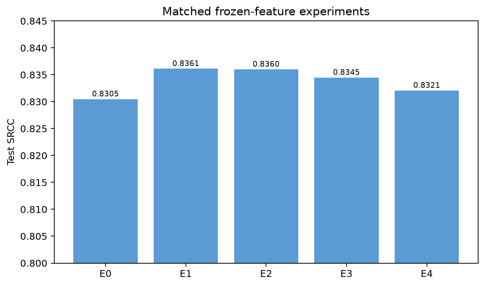
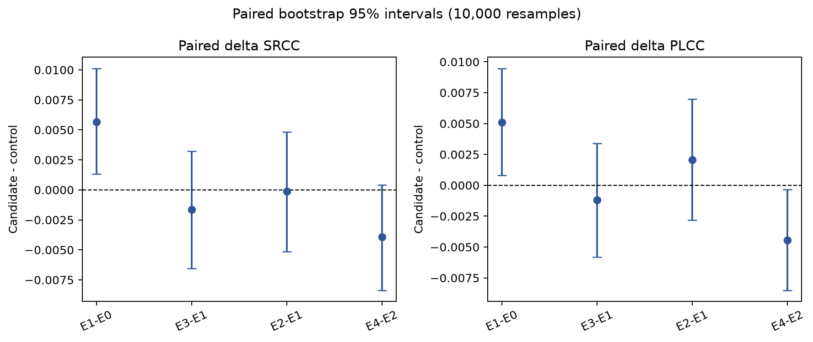
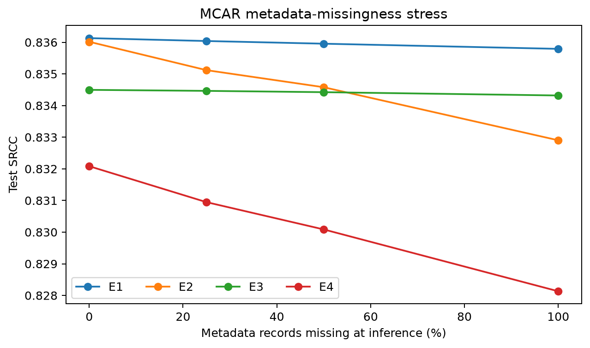
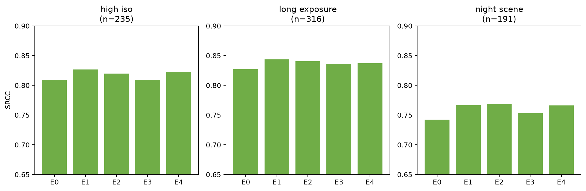

# Experiment report

## Abstract

We test when EXIF metadata improves no-reference smartphone image-quality prediction on SPAQ. Authentic MOS, scene labels, author APEX features, source EXIF, and embedded EXIF provenance were recovered and joined to 11,125 images by exact filename. A repeated-content audit identified 1,069 exact/near-duplicate candidate edges; all connected content was kept within one partition. On the resulting 7,786/1,111/2,228 train/validation/test split, five MOS heads share one frozen ImageNet-V2 ResNet-50 representation. Additive EXIF improves image-only SRCC by 0.00565 with paired-bootstrap 95% interval [0.00132, 0.01013]. A larger gated fusion model does not reliably improve the additive model. Training-time metadata dropout is neutral or harmful and does not improve performance under 0/25/50/100% test-time record missingness. The result supports a small EXIF contribution in this resource-adapted track, while rejecting claims that more complex fusion or dropout is automatically better.

## Questions and scholarly positioning

The confirmatory question is whether held-out SRCC differs between each model and its matched control. H0 is no reliable positive difference; H1 allows a benefit from metadata, fusion, or dropout but does not assume it. Fixed contrasts are E1-E0, E2-E1, E3-E1, and E4-E2. SRCC is primary; PLCC and MAE are secondary.

Fang et al. introduced SPAQ and additive EXIF fusion in *Perceptual Quality Assessment of Smartphone Photography* (CVPR 2020, [paper](https://openaccess.thecvf.com/content_CVPR_2020/html/Fang_Perceptual_Quality_Assessment_of_Smartphone_Photography_CVPR_2020_paper.html), DOI 10.1109/CVPR42600.2020.00373). Their Table 4 values are paper-reported, not results from this repository. The official repository provides demo code but no complete official training pipeline, so this work is a controlled adaptation, not exact reproduction.

TOPIQ (Chen et al., IEEE TIP 2024, [paper](https://doi.org/10.1109/TIP.2024.3378466)) is the Q1 image-only reference. Its published SPAQ result uses a different model and protocol. We do not treat a pretrained TOPIQ checkpoint as a matched control or claim to reproduce TOPIQ training.

## Dataset recovery and integrity

The official Google Drive URL is inaccessible. SPAQ issue #38 records the repository author's 2026-03-11 recommendation of `chaofengc/IQA-PyTorch-Datasets/spaq.tgz`.

| Object | Revision | Bytes | SHA-256 | Verified contents |
|---|---|---:|---|---|
| Q-Align `spaq.tar` | `3da8831b...e376` | 2,626,897,920 | `d312242f...2194` | 11,125 readable re-encoded JPEGs; no tables or embedded EXIF |
| IQA-PyTorch-Datasets `spaq.tgz` | `f97c4f5d...1bef` | 34,841,101,349 | `54e0cb49...7418f7` | 11,125 originals; MOS/attribute, scene, and EXIF workbooks |

The workbooks reproduce the flattened mirror exactly across 11,125 identifiers and 24 values. Embedded EXIF was inspected for every original. Scene brightness is measured in 8,546 rows and author-estimated in 2,579; provenance masks preserve this distinction. `03461.jpg` has invalid raw exposure and remains invalid. No label or EXIF value is synthesized. Raw images/workbooks are not committed because a mirror license does not establish redistribution rights for every SPAQ photograph.

## Split and repeated-content control

Full hashing found 322 exact pairs; 321 have different MOS. The inherited Q-Align split leaks 103 exact pairs. A 64-bit dHash search through radius four added 747 non-exact candidates. Review across distances 0-4 confirmed repeated captures, so all 1,069 edges are conservatively grouped. Seed 20261109 produces 7,786 train, 1,111 validation, and 2,228 test images in 10,340 groups, with zero candidate-edge crossings.

## Models and controls

All variants share torchvision ResNet-50 ImageNet1K-V2 preprocessing and a frozen 2,048-dimensional cache. The image head has 528,897 parameters. Eight author APEX fields are robust-scaled using training medians/interquartile ranges only and accompanied by eight availability indicators.

- E0: image-only MOS head.
- E1: E0 plus a 16-parameter bias-free scalar EXIF offset; zero metadata falls back to the generic prediction.
- E2: zero-initialized metadata-conditioned feature modulation, adding 8,704 metadata parameters.
- E3: E1 with 50% whole-record metadata dropout during training.
- E4: E2 with the same dropout.

Metadata models use an equally weighted generic-image L1 and combined-output L1 objective. All use seed 20261109, batch 256, at most 300 epochs, patience 30, and validation SRCC selection. Test predictions are emitted once from the selected checkpoint.

## Execution and compute

A 16-image real-data slice completed forward/backward, 20 updates, atomic checkpointing, bit-exact reload, and optimizer resume; peak allocation was 1.20 GB. A four-image sanity subset reduced L1 from 54.29 to 1.49 (minimum 0.17) over 200 updates.

Full feature extraction took 119.76 seconds on a local RTX 4050 Laptop GPU at 92.89 images/s and 296 MB peak allocation. E0-E4 took 5.09, 8.25, 7.40, 6.82, and 10.18 seconds. Extraction plus all heads was 157.5 seconds; analysis adds roughly two minutes. Separately, private Kaggle kernel `longltrnhong/spaq-exif-robustness-smoke` v2 completed on a Tesla T4 with 15.64 GB VRAM. It verified the manifest and exact 300-image sample tree hash, measured 11.09 seconds for inference and 2.39 seconds for 20 training steps, peaked at 580 MB allocated VRAM, and passed checkpoint reload plus optimizer resume. Projected 11,125-image inference with a 20% buffer is 493.65 seconds.

## Main results

| Experiment | Best epoch | Test SRCC | Test PLCC | Test MAE |
|---|---:|---:|---:|---:|
| E0 | 52 | 0.83048 | 0.83063 | 9.3489 |
| E1 | 96 | **0.83613** | 0.83572 | 9.1942 |
| E2 | 45 | 0.83602 | **0.83779** | **9.1179** |
| E3 | 67 | 0.83450 | 0.83452 | 9.2534 |
| E4 | 37 | 0.83208 | 0.83337 | 9.3265 |

Ten thousand bootstrap samples resample the same 2,228 image IDs for candidate and control.

| Contrast | ΔSRCC [95% CI] | ΔPLCC [95% CI] | ΔMAE [95% CI] |
|---|---|---|---|
| E1-E0 | +0.00565 [0.00132, 0.01013] | +0.00510 [0.00082, 0.00947] | -0.1547 [-0.2916, -0.0151] |
| E3-E1 | -0.00163 [-0.00657, 0.00323] | -0.00121 [-0.00582, 0.00341] | +0.0591 [-0.0883, 0.2059] |
| E2-E1 | -0.00012 [-0.00516, 0.00484] | +0.00207 [-0.00282, 0.00696] | -0.0764 [-0.2276, 0.0752] |
| E4-E2 | -0.00393 [-0.00837, 0.00041] | -0.00443 [-0.00850, -0.00032] | +0.2087 [0.0711, 0.3475] |

E1's advantage over E0 is consistent across metrics under paired image resampling. No E2-E1 interval excludes zero. E4 is worse than E2 for PLCC and MAE. One training seed means these are not optimization-variability claims.

## Missingness robustness

Test MCAR masks remove entire metadata records on identical IDs at 0/25/50/100% missingness. Five fixed mask seeds are used at 25% and 50%.

| Model | 0% missing | 25% | 50% | 100% |
|---|---:|---:|---:|---:|
| E1 | 0.83613 | 0.83604 | 0.83595 | 0.83579 |
| E2 | 0.83602 | 0.83512 | 0.83458 | 0.83290 |
| E3 | 0.83450 | 0.83446 | 0.83442 | 0.83432 |
| E4 | 0.83208 | 0.83095 | 0.83009 | 0.82813 |

Dropout does not beat its no-dropout control at any availability. E1 changes little because its learned metadata correction is small; E2 is more sensitive to removal.

## Capture-condition subgroups

Training-only thresholds define high ISO as `source_iso ≥ 800`, long exposure as valid source exposure ≥ 0.058824 s, and night as an authentic nonzero night label. These overlapping analyses are descriptive.

| Subgroup | n | E0 | E1 | E2 | E3 | E4 |
|---|---:|---:|---:|---:|---:|---:|
| High ISO | 235 | 0.8093 | **0.8267** | 0.8200 | 0.8088 | 0.8225 |
| Long exposure | 316 | 0.8272 | **0.8434** | 0.8402 | 0.8361 | 0.8374 |
| Night scene | 191 | 0.7425 | 0.7667 | **0.7680** | 0.7528 | 0.7662 |

Night scenes are hardest for every model. E1 leads high-ISO and long-exposure SRCC; E2's 0.0013 night lead over E1 is not a prespecified inferential claim.

## Error analysis

E1 was selected because it had the highest validation SRCC. The review deterministically takes the 20 largest absolute held-out errors. Thirteen are overpredictions and seven underpredictions; median absolute error is 34.77 and maximum 49.88. Low-MOS overprediction and high-MOS underprediction occur across multiple makes/models, consistent with regression toward the center rather than one EXIF failure mode. Exact rows are in `evidence/top_errors_e1_s20261109.csv`; images are not redistributed.

## Threats to validity

1. Compact re-encoded inputs differ from original full-resolution images; annotations are joined from verified originals by filename.
2. One training seed prevents training-variance claims; bootstrap covers finite test-image sampling only.
3. Conservative dHash grouping may merge rare false positives, while the alternative demonstrably leaks repeats.
4. Raw device strings contain aliases/outliers, so no unseen-device/OOD claim is made.
5. Subgroups overlap and are exploratory.
6. The Kaggle job is a compute/data/checkpoint smoke test, not an additional E0-E4 training seed.
7. Redistribution rights are not inferred from mirror metadata.

## Conclusion and evidence

EXIF supplies a small measurable benefit through simple additive fusion in this resource-adapted track. More parameters do not reliably help, and dropout does not improve missingness robustness. Preserve an independently valid image branch and explicit availability masks; prefer E1 unless repeated-seed evidence supports gating.

Machine-readable evidence is in `evidence/e0_frozen_r50_s20261109.json` through `evidence/e4_frozen_r50_s20261109.json`, `evidence/missingness_all_s20261109.json`, `evidence/analysis_summary_s20261109.json`, and `evidence/kaggle_smoke_v2.json`. Full provenance is in `data/provenance.json`; chronological claims are in `EVIDENCE_LOG.md`.
